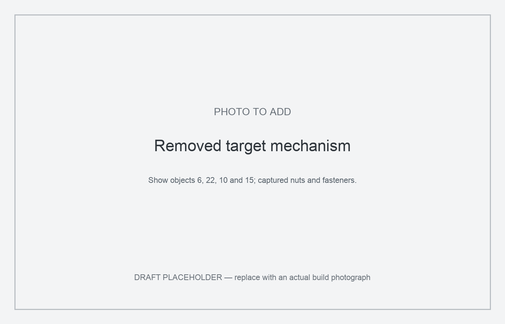
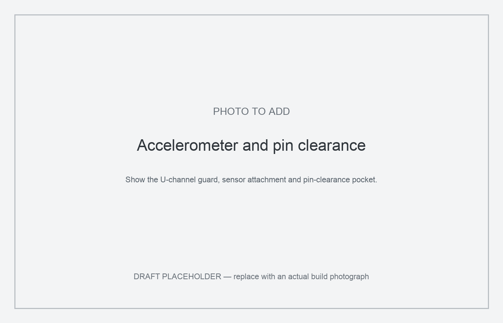
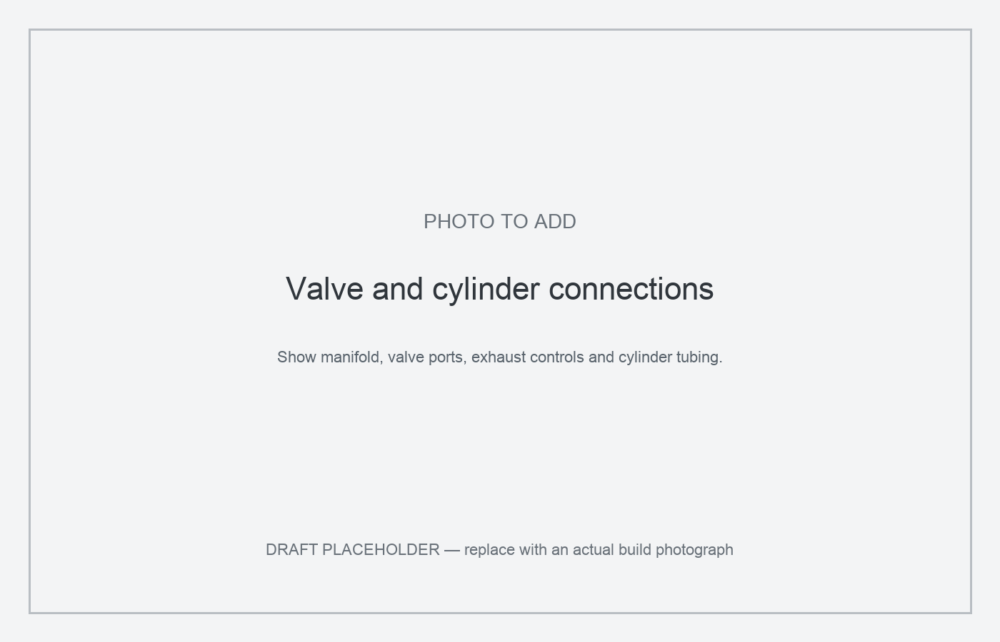
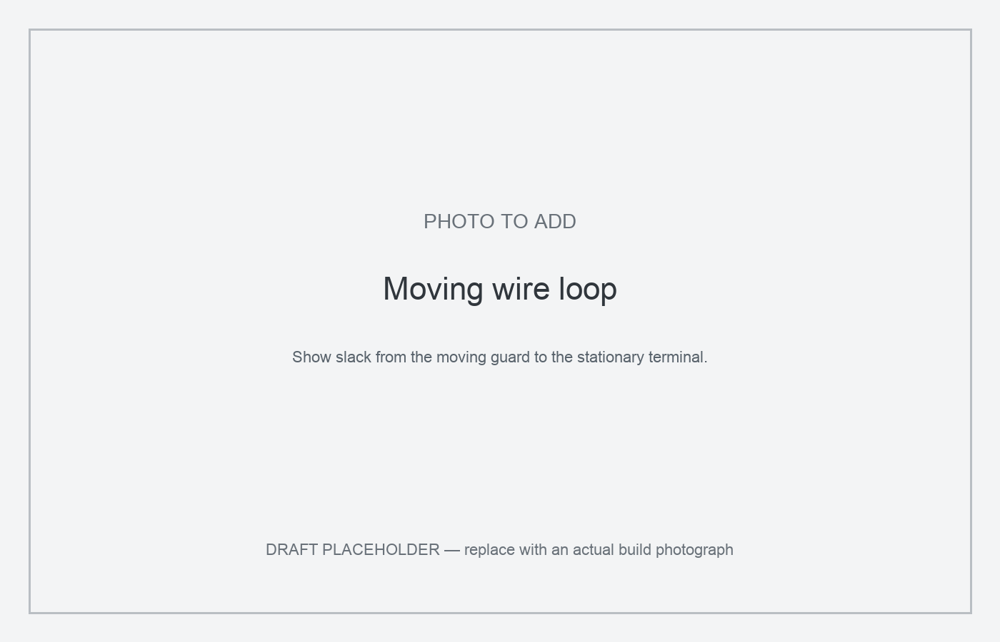

# Build a Customizable Pneumatic Whack-a-Mole Arcade Cabinet

The standalone software is licensed under MIT. The creator's print files, article, diagrams and build photographs are licensed under [CC BY 4.0](https://creativecommons.org/licenses/by/4.0/). Credit crackpotgumption, link to the license and indicate changes. See LICENSES.txt for the software license and scope. Third-party materials retain their own terms.

This is a five-target pneumatic whack-a-mole cabinet. Each target uses a double-acting air cylinder, an accelerometer and an illuminated collar. An Arduino Mega controls the hardware, and a Linux computer runs the standalone game and audio.

The mechanisms are mounted on a separate deck for alignment and maintenance. Printed adapters allow the decorations to be changed without rebuilding the mechanism.

The cabinet originally ran custom game logic for an event. This guide covers the cabinet build and an independent standalone Start-button game.

The cabinet measures 37.5 inches wide × 24 inches deep × 36 inches high, excluding casters. The production 3MF is complete. Final drawings, wiring verification and cabinet testing of the standalone software are still in progress.

## Supplies

*Amazon links are affiliate links. As an Amazon Associate I earn from qualifying purchases.*

Quantities below describe one cabinet. Pack sizes and spool/tube lengths describe the linked purchase, not the amount required. Prices are omitted.

## Cabinet

- [Grip-Rite #8 × 2-inch construction screws, 2GCS1](https://www.homedepot.com/p/Grip-Rite-8-x-2-in-Star-Drive-Dual-Flat-Head-Coarse-Thread-Construction-Screws-1-lb-Box-2GCS1/204959257): 2×2-to-plywood connections; also caster fasteners where they enter the inner 2×2 rail.
- Four [3-inch rubber swivel casters with brakes, Harbor Freight item 61855](https://www.harborfreight.com/3-in-rubber-light-duty-swivel-caster-with-brake-61855.html). Mount about 1 inch in from the corners, catching the inner 2×2 framing on at least one side. Use 2-inch screws into the rail and ¾-inch screws on the other side.
- Screw-use clarification: 2½-inch screws were used for 2×2-to-2×2 connections; 2-inch screws for 2×2-to-plywood connections. Do not use the 2½-inch frame screws for the plywood connection pattern.

Confirmed ¾-inch plywood cuts: three 36 × 24-inch panels (two sides and top/playfield), one 36 × 23.25-inch bottom, one 36 × 35.25-inch front, and two 19.2 × 35.75-inch deck panels. The bottom's ¾-inch front setback allows the front panel to drop down and align with the sides. See PLYWOOD_CUT_LIST.md; sheet nesting and hole details remain to be drawn.

- Five [Oatey Fast Set flanges, model 435032, 3-inch outside fit / 4-inch inside fit](https://www.homedepot.com/p/Oatey-Fast-Set-3-in-Outside-Fit-or-4-in-Inside-Fit-PVC-Open-Hub-Toilet-Flange-435032/100344482).
- [Charlotte Pipe 3-inch Schedule 40 PVC, 2-foot purchase length](https://www.homedepot.com/p/Charlotte-Pipe-3-in-x-2-ft-PVC-DWV-Sch-40-Pipe-PVC073000200HA/100533056). Cut five 2-inch sleeves. About one foot including cutting waste is sufficient; buy a shorter length or request store cuts if available.
- [Everbilt #8 × 1-inch flat-head wood screws, 100-pack](https://www.homedepot.com/p/Everbilt-8-x-1-in-Zinc-Plated-Phillips-Flat-Head-Wood-Screw-100-Pack-801822/204275495): mechanism and flange fastening; at least 40 for puck/base mounts plus flange screws and spares.
- [Everbilt #8 × ¾-inch flat-head wood screws, 100-pack](https://www.homedepot.com/p/Everbilt-8-x-3-4-in-Phillips-Flat-Head-Zinc-Plated-Wood-Screw-100-Pack-801812/204275494): shorter mounting fasteners; final placement/count to be documented.
- [Grip-Rite #8 × 2½-inch general-purpose wood screws](https://www.homedepot.com/p/Grip-Rite-8-x-2-1-2-in-2-Phillips-Bugle-Head-Coarse-Thread-Wood-Screws-1-lb-Box-212GS1/100128995): frame joints.
- [Kreg K4 pocket-hole jig](https://www.amazon.com/dp/B001DYFISG?tag=crackpotgum00-20): one tool.
- [LIONMAX #8 × 2½-inch pocket-hole screws](https://www.amazon.com/dp/B0C23LJ6LJ?tag=crackpotgum00-20): pocket-hole joints in the nominal 2×2 framing; linked pack contains 300 screws, not the required cabinet quantity.
- Pneumatic thread tape is supplied with the tubing/solenoid purchases. No separate tape purchase is needed for the documented build; use only on compatible threaded joints.

| Supply | Quantity | Use / remaining check |
|---|---|---|
| [ZANEXIR black felt sheet, 36 × 36 inches, 1 mm](https://www.amazon.com/dp/B0GV7ZK5MX?tag=crackpotgum00-20) | 1 sheet | Trim for the 36 × 34.5-inch rear cover. Confirm stiffness/suitability; listing is 1 mm, not heavy felt. |

## Pneumatics

| Supply | Quantity | Use / remaining check |
|---|---|---|
| [TAILONZ MAL16×75 double-acting cylinder, 16 mm bore × 75 mm stroke](https://www.amazon.com/dp/B08CZ39Y42?tag=crackpotgum00-20) | 5 | Includes fittings listed as 6 mm. The builder confirms these work with the linked ¼-inch tubing in the completed build. Rod/base thread sizes remain to be recorded. |
| [AIRIX 4V210-08 12 V five-way, two-position valve, ¼-inch NPT](https://www.amazon.com/dp/B0F2MQF6K7?tag=crackpotgum00-20) | 5 | Listing states 25–116 PSI and pilot operation. Confirm operation at the approximately 25 PSI setting under load; verify physical port markings. |
| [TAILONZ blue polyurethane air tubing, ¼-inch OD, 200 ft](https://www.amazon.com/dp/B09CPG48SL?tag=crackpotgum00-20) | As needed | Compressor/manifold/valve/cylinder runs; 200 ft is purchase length, not a one-cabinet requirement. |
| [TAILONZ straight push fittings, ¼-inch tube OD × ¼-inch MNPT, 20-pack](https://www.amazon.com/dp/B08F4YHR1V?tag=crackpotgum00-20) | Count after routing | For compatible ¼-inch NPT ports; not assumed to fit cylinder ports. |

## Power and electronics

| Supply | Quantity | Use / remaining check |
|---|---|---|
| [Amazon Basics six-outlet surge-protected power strip, 2-pack](https://www.amazon.com/dp/B0D1XNYKD5?tag=crackpotgum00-20) | 1 strip | Electronics only. Compressor has a separate external cord/outlet. |
| [12 V 5 A power adapter](https://www.amazon.com/dp/B07GFFG1BQ?tag=crackpotgum00-20) | 1 | Valve-coil supply; separate from 5 V supply. |
| [AITRIP TCA9548A eight-channel I²C multiplexer, 6-pack](https://www.amazon.com/dp/B08JGSMRF9?tag=crackpotgum00-20) | 1 board | Five sensors use channels 0–4; purchase pack contains spares. |
| [Mega 2560 screw-terminal breakout board](https://www.amazon.com/dp/B0BY8SHQZS?tag=crackpotgum00-20) | 1 | Controller wiring termination. Check fit against the actual Mega; listing has inconsistent board-compatibility text. |
| [ELEGOO Mega 2560 R3 board](https://www.amazon.com/dp/B01H4ZDYCE?tag=crackpotgum00-20) | 1 | Hardware controller, USB-powered by host. |

## Wiring

- [18 AWG feeder wire](https://www.amazon.com/dp/B07FMWNF3J?tag=crackpotgum00-20), as needed for the deck power feeders.
- The linked Fermerry 22 AWG wire is the builder's general-use wiring; keep the 18 AWG power feeders separate.

- [WAGO 221-412 two-conductor lever connectors](https://www.amazon.com/dp/B00JB3U7Y6?tag=crackpotgum00-20), as needed for harness connections.
- [Zip-tie mounts](https://www.amazon.com/dp/B09B8NY4SN?tag=crackpotgum00-20), as needed for cable routing and moving-wire management.

| Supply | Quantity | Use / remaining check |
|---|---|---|
| [Mini PCB screw-terminal connector assortment, 2.54 mm pitch](https://www.amazon.com/dp/B0FCXV6GT3?tag=crackpotgum00-20) | As needed | Sensor and low-voltage wiring connections; not the main power-distribution blocks. |
| [Amazon Basics multicolor electrical tape, 10-pack](https://www.amazon.com/dp/B07YDSNGCT?tag=crackpotgum00-20) | As needed | Wire labeling and insulation. |
| [Fermerry 22 AWG silicone stranded wire, six colors, 100 ft each](https://www.amazon.com/dp/B089D3LVYK?tag=crackpotgum00-20) | As needed | Low-current signal/sensor wiring and suitably sized pigtails; retain larger deck feeders sized for load. |

## Printed parts

| Supply | Quantity | Use / remaining check |
|---|---|---|
| [ELEGOO black PLA Plus, four 1 kg spools](https://www.amazon.com/dp/B0C7GDB9GQ?tag=crackpotgum00-20) | As needed | Black structural parts. Generic PLA is the saved slicer profile; material amount is not yet estimated. |
| [ELEGOO white PLA, four 1 kg spools](https://www.amazon.com/dp/B0BV24RX9Q?tag=crackpotgum00-20) | As needed | White diffuser rings; select white filament rather than the saved black project color. |

## Finish

| Supply | Quantity | Use / remaining check |
|---|---|---|
| [TECKWRAP silver chrome adhesive vinyl, 1 ft × 5 ft](https://www.amazon.com/dp/B07CZCZ4MB?tag=crackpotgum00-20) | As needed | Cabinet graphics and accents. |
| [Flutesan silver ¾-inch T-molding, 25 ft](https://www.amazon.com/dp/B0H8YJY3ZR?tag=crackpotgum00-20) | As needed | Cabinet edge trim; match slot cutter to trim and test on scrap. |
| [Rust-Oleum Bright Coat chrome spray paint, 11 oz](https://www.amazon.com/dp/B000Z8DGXK?tag=crackpotgum00-20) | As needed | Chrome finish on printed collars and accents. |

## Tools and adhesives

| Supply | Quantity | Use / remaining check |
|---|---|---|
| [Surebonder CL-800F full-size cordless hot glue gun](https://www.amazon.com/dp/B001AH5EXK?tag=crackpotgum00-20) | 1 tool | Collar retention and mounting; keep serviceable parts removable. |
| [Gorilla heavy-duty double-sided mounting tape, 1 × 120 inches](https://www.amazon.com/dp/B082TQ3KB5?tag=crackpotgum00-20) | As needed | Mounting panels and speakers; consider later removal. |
| [Self-adjusting ferrule crimper with ferrule assortment](https://www.amazon.com/dp/B0DRJ9CDNG?tag=crackpotgum00-20) | 1 tool kit | Terminate stranded wires in compatible screw terminals; match ferrule to wire size. |
| [Oatey PVC cement and purple primer handy pack](https://www.amazon.com/dp/B0002YU23O?tag=crackpotgum00-20) | 1 kit | Solvent-weld compatible PVC sleeves and closet flanges. |

## Other required supplies already specified

Pneumatic routing: each valve's default, de-energized state sends air to the top of its associated cylinder. Builder reports no additional pneumatic hardware beyond the linked fittings and cylinder-supplied fittings.

- ¾-inch plywood and nominal 2×2 lumber: use the cabinet/deck cut lists in the build steps.
- Five compatible closet flanges, five 2-inch sections of nominal 3-inch Schedule 40 PVC, casters, hook-and-loop fastening and wood screws.
- Ten [Pneuforce BESL-01 exhaust muffler/flow controls](https://pneuforce.com/pneumatic-exhaust-muffler-besl-01), two per valve. Builder identifies these as the installed parts.
- One [FORTRESS 2-gallon, 135 PSI ultra-quiet oil-free compressor, Harbor Freight item 64596](https://www.harborfreight.com/2-gallon-135-psi-ultra-quiet-oil-free-hand-carry-jobsite-air-compressor-64596.html). Use its regulated outlet; tank maximum pressure is not the cabinet operating pressure.
- One [six-connection manifold](https://www.amazon.com/dp/B0FCYNYHQF?tag=crackpotgum00-20).
- Five [MPU6050 breakout boards](https://www.amazon.com/dp/B0F9DLNHTB?tag=crackpotgum00-20); verify breakout voltage/pullups.
- One [Adafruit #6318 solenoid driver](https://www.adafruit.com/product/6318).
- 95 installed pixels (19 per collar), plus optional spares from [NeoPixel strip #1460](https://www.adafruit.com/product/1460); builder confirms 19 per collar.
- One [5 V 10 A supply](https://www.amazon.com/dp/B0D76F4W1C?tag=crackpotgum00-20), and five [power-distribution blocks](https://www.amazon.com/dp/B07CLW5FPS?tag=crackpotgum00-20) sized as described in the wiring step.
- One host computer, for example a [used small-form-factor workstation](https://www.ebay.com/itm/398398540633). The builder used similar computers with varying models; the listing is an example, not an exact required model. It needs USB power and data for the Arduino Mega, USB-speaker or other audio-output support, and the ability to run Python. A Raspberry Pi could also serve as the host. Size and computing power were not selection constraints.
- One pair of [Logitech S150 USB speakers](https://www.amazon.com/dp/B000ZH98LU?tag=crackpotgum00-20).
- [Amazon Basics USB-A to USB-B cable](https://www.amazon.com/dp/B00NH13DV2?tag=crackpotgum00-20), optional longer cable for bench testing. The cable included with the Mega can be used in the cabinet.
- Suggested [Twidec normally-open momentary Start button, 16 mm variant](https://www.amazon.com/dp/B08JHVLK84?tag=crackpotgum00-20), one used from the pack. Suggested for the standalone build, not an identified original button. Measure the received button before drilling. Connect between the Start input and ground using INPUT_PULLUP.
- Five each of printed body, retainer, guard, cylinder base, collar and diffuser; optional decoration adapters. Use the confirmed production 3MF and preserve its modifier and negative volumes.
- At least forty #8×1-inch countersunk screws for retainer/base mounts and ten captured nuts supplied with the linked cylinders; reuse them in the printed mounts rather than buying separate nuts.
- Black paint, satin water-based clearcoat, optional chrome marker, strain relief, cable mounts and appropriate circuit protection.

## Step 1: Plan the cabinet and work safely

Label the front targets 0, 1 and 2 from left to right, and the back targets 3 and 4. Keep valve, sensor and ring labels consistent. On the 36 × 24-inch playfield, measure centers from the front-left corner as (left, depth): (6,6), (18,6), (30,6), (12,18), (24,18), in inches. Cut five 8.5-inch openings, testing a finished collar against scrap first.

Use two external cords: compressor directly to a suitable outlet, electronics to their own internal strip. Do not connect the compressor to the electronics strip. Before servicing, shut down Linux, isolate power and release stored air through controlled venting. Beware auto-restart, trapped pressure and moving rods. Enclose mains terminals, provide strain relief and appropriate protection, and seek qualified mains help where needed. Secure heavy equipment and use soft decorations. No dedicated emergency stop was present in the original cabinet.

## Step 2: Build the cabinet frame and removable deck

Build the outer frame's approximately 36 × 22.5-inch top and bottom rectangles, with a centered bottom crossmember. Join them using six 31.5-inch uprights at the corners and centers of the long sides. Pocket-screw the short horizontal members; other joints used 2.5-inch screws. Add two interior 36-inch rails about 15 inches below the upper rails for the deck.

Cut three 36 × 24-inch plywood panels for the two sides and top/playfield. Cut the bottom 36 × 23.25 inches and the front 36 inches wide × 35.25 inches tall. All are ¾-inch plywood. The bottom is ¾ inch shorter at the front so the front panel can drop down and align with the sides. I fastened plywood from inside with 2-inch screws and omitted glue for disassembly. A recessed 36 × 34.5-inch felt rear panel attaches with hook-and-loop fastening.

Build two nominal 36 × 19.2-inch deck frames with centered 33-inch crossmembers and four short uprights. Fit two 19.2 × 35.75 × ¾-inch plywood panels, leaving the bottom solid. The top has approximately 4.25-inch flange openings centered at (6,3.75), (18,3.75), (30,3.75), (12,15.75), (24,15.75) inches. Center the deck between the cabinet rails. Measure each hole layout from its own panel’s front-left corner; the different depth coordinates account for the different panel origins and align the targets vertically. Screw it to support rails and tie columns together, preserving service gaps.

*Photos: frame pieces, uprights, batch deck assembly and raw cabinet on casters.*

Use 2½-inch screws for 2×2-to-2×2 joints and [Grip-Rite #8 × 2-inch screws](https://www.homedepot.com/p/Grip-Rite-8-x-2-in-Star-Drive-Dual-Flat-Head-Coarse-Thread-Construction-Screws-1-lb-Box-2GCS1/204959257) for 2×2-to-plywood connections. Mount four [Harbor Freight 61855 casters](https://www.harborfreight.com/3-in-rubber-light-duty-swivel-caster-with-brake-61855.html), about 1 inch inset from the corners. Catch the inner 2×2 frame on at least one side: use 2-inch screws into that rail and ¾-inch screws on the other side.

## Step 3: Assemble the printed mechanisms

The production 3MF contains six build plates and ten objects. Open it as a project so its modifiers and negative volume remain intact. The saved general profile is Bambu P1S, 0.4 mm nozzle, Generic PLA, 0.20 mm layers, three walls, 15% grid infill, five top layers, three bottom layers, supports disabled and automatic brim. Verify these settings for your printer and filament.

The collar plate uses 0.24 mm layers, two walls and 15% zigzag infill. On plate 5, object 6 is the cylinder bottom-to-deck mount, capturing the larger supplied hex nut and fastening to plywood through countersunk holes. Object 22 is the rod-to-body mount/retainer puck, capturing the rod hex nut and screwing to the mole body's flat platform; preserve its 100% infill modifier. Object 10 is the main body, with its cylindrical guide inside the 3-inch PVC sleeve and a flat decoration platform on top. Object 15 is the U-channel anti-rotation guard and accelerometer mount; its negative cube provides clearance for the sensor pins. Select white filament for the diffusers even though the project color is saved as black.

Solvent-weld each 2-inch PVC segment into its flange. Fit the flange from above: the rim rests on plywood and the PVC points downward. Secure it with 1-inch screws.

Build one mechanism on the bench. Connect the cylinder rod to the puck's captured nut, attach the puck beneath the body with four #8 × 1-inch screws, and fit the U-guard beneath it around the cylinder fittings. Mount the sensor consistently with Y vertical. Attach the bottom cylinder stud to the base mount's captured nut. Prewire and leak-test before installation, then isolate/depressurize and remove temporary tubing.

Lower the assembly into its sleeve, align the base and fasten it to the lower deck using four #8 × 1-inch screws. A compact/right-angle driver helps. Connect permanent tubing afterward. Secure moving sensor wires to the guard with a generous loop to a stationary terminal, then fixed wiring to buses/mux.

The mechanisms were built in PLA. PETG and TPU have not been validated for these parts. Preserve the local solid-infill modifier and negative volume. Optional adapters support replaceable soft decorations.

*Photo: rear deck and mounts. Detailed teardown images remain pending.*





## Step 4: Plumb the five channels



Plumb each valve so its default, de-energized state sends air to the top of its associated cylinder. Air supplied to the top port retracts the piston and lowers the target, while air from the bottom end exhausts through the valve. Energizing the valve supplies air to the bottom port, extending the piston and raising the target while the top end exhausts. The piston positions in the valve-state drawing illustrate these lowered and raised states.

Each target uses one AIRIX 4V210-08 12 V five-way, two-position valve and one TAILONZ MAL16×75 double-acting cylinder. Route regulated compressor air into the manifold, its five branches into the numbered valve supplies, and each valve's two working ports to its cylinder. Verify the physical port labels and extend/retract direction before committing the plumbing. Fit two flow controls to each valve's exhaust ports. The valves sit at the lower right and compressor at the left, viewed from behind.

The MAL16×75 cylinders include fittings listed as 6 mm. The builder confirms that these fittings work with the linked ¼-inch OD tubing in this cabinet. Cut tubing square and seat it fully. Use thread sealant only on compatible joints according to manufacturer guidance. The valve listing specifies 25–116 PSI and pilot operation; confirm reliable switching under the installed load near the cabinet's approximately 25 PSI operating point. Leak-test and cycle one target at a time within every component's pressure rating. Never overpressurize to free a sticking cylinder.

With the host stopped, upload the piston diagnostic and open Serial Monitor at 115200/newline. Test 0–4 or ALL; STOP cancels. It compares Y-axis resting baseline with extension/retraction traces. This measures acceleration response, not speed or end position. Tune flow with observed motion and repeatable loads. The independent diagnostic leaves reference advice off by default; optional references need physically confirmed exhaust directions.

## Step 5: Wire sensors, driver and collars



Power the Mega only through computer USB. Keep separate 5 V and 12 V positive rails with common DC ground. Distribute power through master and deck buses, numbered at both ends. Size wires/protection for load and length; secure supplies and enclose mains.

Connect Mega D20/SDA and D21/SCL to driver and mux. Driver outputs and mux channels 0–4 follow target IDs; expected addresses are 0x20, 0x70 and 0x68 respectively. The raw MPU6050 is not 5 V tolerant; verify the actual breakout regulation, pullups and logic levels before wiring.

The installed MPU6050 breakout boards also receive VCC from the dedicated 5 V rail. This describes the breakout-board input supply, not the bare MPU6050 chip rating.

Power the Adafruit #6318 logic Vcc and the TCA9548A from the dedicated 5 V rail. The Mega remains USB-powered; do not connect the external 5 V rail to its 5 V pin. Driver V+ supplies the 12 V coils. Coils connect between positive terminals and numbered switched outputs with common ground. Verify labels in [Adafruit's pinout guide](https://learn.adafruit.com/adafruit-i2c-to-8-channel-solenoid-driver/pinouts). The driver includes output drivers and flyback protection.

Seat cut NeoPixel strips in printed collars and gently spring matte-white diffusers into their lips; avoid/stagger seams and keep spares. Data D14–D18 matches rings 0–4. Confirm pixel count/data direction. Follow [Adafruit's power guidance](https://learn.adafruit.com/adafruit-neopixel-uberguide/powering-neopixels), including capacitor/data resistor recommendations; these are review additions rather than documented original components.

Connect a normally-open Start button between Mega D24 and ground using INPUT_PULLUP. Keep moving loops away from tubing; verify matching channel/ring/output with air disconnected before pressure tests.

## Step 6: Finish and customize

Remove serviceable components before finishing. I used two rolled coats of Glidden black semi-gloss paint/primer and two coats of Minwax satin water-based clear. Chrome-painted collars and vinyl accents completed the arcade look. Follow product curing instructions and keep sliding surfaces clean.

Test T-molding's slot on scrap: my cutter made it too wide, so the barbs did not grip and trim lips had to be glued. Use a matched cutter or adhesive trim. Preserve rear access and removable collars. Soft decorations on separate adapters let you change the theme without rebuilding the mechanisms.

*Photos: seam filling, nearly finished exterior and completed three-quarter view.*

## Step 7: Install the standalone game

Press Start for a short countdown and thirty-second round. Idle collars display rainbows; game collars are red with the active target yellow. One successful hit adds one point and two green flashes. Timeouts have no penalty. Choose among the other four positions after each appearance. The next target may rise before the last finishes descending; no end-position sensor is available. Round end requests all down, then a short chase returns to idle.

Download the seven files attached to Step 7 and arrange the Python files in software/python/, test_game.py in software/tests/, and each Arduino sketch in its same-named folder under software/arduino/. Keep standalone_setup.txt with the package.

Use the independent software folder. Upload STANDALONE.ino for Mega with Adafruit NeoPixel, MCP23017 and BusIO libraries. Use the nineteen-pixel setting and D24 Start-button pin. Close Serial Monitor and run the Linux host from its software folder:

```sh
python3 -m venv .venv
.venv/bin/pip install -r python/requirements.txt
.venv/bin/python python/run.py --port /dev/ttyACM0
```

Use the actual device path. A JSON --config overrides timing, color and detection settings. Optional --sounds loads start.wav, appear.wav, hit.wav and game_over.wav through asynchronous aplay. Missing sounds do not stop play.

Both sketches compile for Mega and six mocked state-machine tests pass. The Y-only threshold/settling defaults remain provisional pending cabinet traces and testing.

## Step 8: Test, tune and play

Verify supply voltages, sensor communication and matching labels without air. Then check movement, wiring slack, leaks and de-energized direction at controlled pressure. Record resting/movement/hit traces, including neighboring motion, before selecting detector settings.

Test countdown/repeated Start, correct-only one-point scoring, one score per appearance, no-repeat hits/timeouts, nonblocking lights/audio, round-end down request, chase and idle. Test controlled serial loss with isolation controls available; I2C faults can prevent an electrical shutdown command reaching the driver.

Binding calls for alignment/load/flow checks. False hits call for mount/harness/trace/settling review. Missing channels call for isolated wiring checks. Flicker calls for data direction/count/ground/power checks. Measure temperatures during a full-length run in the actual venue.

Inspect fasteners, guards, decorations, tubes and moving loops after sessions. Keep spare printed parts, shut Linux down gracefully and release stored air before repairs. Remaining publication work is listed in OWNER_TODOS.md: checked cutting dimensions, breakout-specific wiring and pneumatic diagrams, teardown photos, physical calibration and full cabinet validation.

### Testing results — to be completed

DRAFT PLACEHOLDER: add observations and measurements using TESTING_RESULTS_TEMPLATE.md. No cabinet-testing result has been recorded here yet.

| Check | Recorded result |
|---|---|
| Date, software version and pressure | [RESULT TO ADD] |
| Channel mapping and 19-pixel collars | [RESULT TO ADD] |
| D24 Start button and repeated presses | [RESULT TO ADD] |
| Motion, wire slack and off-state plumbing | [RESULT TO ADD] |
| Threshold, settling time and cooldown | [RESULT TO ADD] |
| False hits from own/neighbor movement | [RESULT TO ADD] |
| Correct-only, single-hit scoring | [RESULT TO ADD] |
| Round end and return to idle | [RESULT TO ADD] |
| USB disconnect/reconnect | [RESULT TO ADD] |
| Extended run and observed issues | [RESULT TO ADD] |
